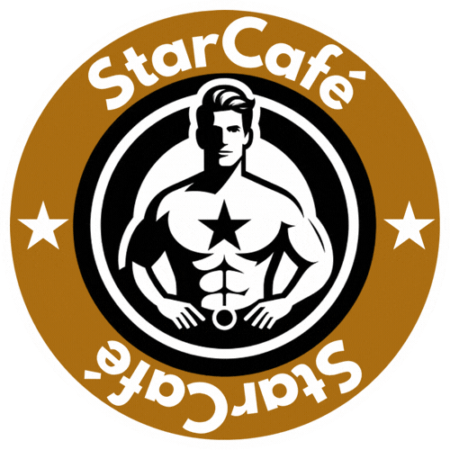

# StarCafé Website  

A sample cafe web application built with HTML, CSS, and **PyScript** for frontend logic, powered by **Firebase** for backend data storage.

## 📁 Project Structure

```text
├── index.html      # Main structure and layout of the cafe website
├── style.css       # Custom styling and responsive design
├── main.py         # PyScript logic and Firebase integration
└── logoAni.gif     # Animated cafe brand logo
```

## 🛠️ Technologies Used

* **HTML5 & CSS3:** Page structure and styling.
* **PyScript:** Runs Python directly in the browser to handle UI logic and database requests.
* **Firebase:** Backend database for storing and retrieving cafe data using REST APIs (e.g., menu items, orders, or reservations).

## 🚀 Getting Started

Because PyScript fetches `main.py` over HTTP, opening `index.html` directly as a local file (`file://`) will trigger browser CORS restrictions. You must run this project on a local server.

### 1. Clone the Repository
```bash
git clone <your-repository-url>
cd <your-repository-folder>
```

### 2. Configure Firebase
1. Create a project in the [Firebase Console](https://google.com) and set up your Firestore.
2. Open `main.py` and locate the `BASE_URL` variable.
3. Replace the existing URL with your own Firebase database endpoint:
   ```python
   BASE_URL = "https://firebaseio.com"
   ```

### 3. Run on a Local Server
Start a local development server using any of the following methods:

* **Using Python:**
  ```bash
  python -m http.server 8000
  ```
* **Using VS Code:**
  Install the **Live Server** extension, right-click `index.html`, and select **Open with Live Server**.

### 4. View in Browser
Open your browser and navigate to `http://localhost:8000` (or the port provided by your local server).
